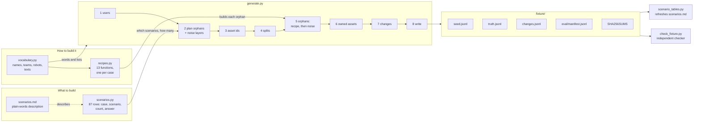

# How the dataset is created

`python generate.py --seed 42 --out fixture/` builds the evaluation fixture: 3,000 assets, 200 users and about 52,000 signals, with 490 orphans whose right answer is known. The same seed always gives byte-identical files.

## Where to start reading

1. **`scenarios.md`**: the scenarios in plain words, with a real example of each and the decisions behind the answers.
2. **`scenarios.py`**: the same table in code. It is the one place to change a count or an answer. `python scenarios.py` prints a summary.

You only need the other files to see *how* the data is built.

## The files

| File | Contains | Size |
|---|---|---|
| `scenarios.py` | **What** is generated: 13 cases and 87 scenarios, each with a count, a right answer (person or none) and a description | ~280 lines |
| `recipes.py` | **How** the evidence is built: one function per case, which sets the right answer first and then writes the signals, description, notes and edges | ~450 lines |
| `vocabulary.py` | **Fixed lists**: teams, robots, names, asset names, and the description and note texts | ~100 lines |
| `generate.py` | **The pipeline**: reads the three files above and runs steps 1–8 | ~740 lines |
| `check_fixture.py` | **The checker**: re-derives every answer from the output files. It shares no code with the generator. | ~910 lines |
| `scenario_tables.py` | **Keeps `scenarios.md` in step with the data**: rewrites its summary and example tables | ~200 lines |

## How they connect



## The pipeline in one line each

| Step | Does |
|---|---|
| 1. users | Creates 200 users, with name clashes planned on purpose (two Akiras on one team, a duplicated full name) |
| 2. plan | Makes one orphan for every count in `scenarios.py`, and spreads the noise layers evenly over each case |
| 3. assets | Shuffles 3,000 asset ids so that an id never reveals the case |
| 4. splits | Sends half of every scenario to `calibration` and half to `held_out` |
| 5. orphans | Runs each orphan's recipe (the answer first, then the evidence), then adds noise that can't change the answer |
| 6. background | Builds the owned assets (3,000 minus the orphans), reusing every text and robot behaviour seen on orphans so orphans don't stand out |
| 7. changes | Writes the human edits: `set_owner`, `delete_asset`, `deactivate_user` |
| 8. write | Sorts and numbers the records, then writes the files and SHA256SUMS |

The split is decided before the orphans are built, because a few wordings may only be used on held_out orphans (next section).

## Text in other wordings

- **What:** 9 scenarios (54 orphans) use notes and descriptions in words the rules scorer does not know, for example "Passing this one to Rafael Castillo from now on." Their names end in `other_wording` or `harmless_text`.
- **Why:** without them the scorer is never wrong on our own data, so we could not measure how sure it should be.
- **The right answer does not depend on the wording.** It is the same as for the known wording.
- **Where the wordings are:** `OTHER_WORDINGS` in `vocabulary.py`. Each kind has two wordings used in both splits and one kept for held_out only.
- **Owned assets carry the same wordings**, so these texts don't give orphans away.

`scenarios.md` section 3.5 has the details.

## Common changes

| To… | Edit |
|---|---|
| change how many orphans a scenario has | the count in its row in `scenarios.py` (keep it even) |
| change an answer (person ↔ none) | the row in `scenarios.py` **and** that case's function in `recipes.py`. The generator stops with an error if they disagree. |
| add a scenario | a row in `scenarios.py` and a branch in that case's function in `recipes.py` |
| add a description wording the rules know | a template in `DESC` in `vocabulary.py`; owned assets pick it up automatically |
| add a note wording the rules know | a template in `NOTE` in `vocabulary.py`, a recipe that uses it, and a line in `build_background` (`generate.py`) that puts it on owned assets. The generator stops with an error if a note text appears only on orphans. |
| add a wording the rules don't know | a line in `OTHER_WORDINGS` in `vocabulary.py`, and a pattern in `check_fixture.py` so the checker can read it. Owned assets pick it up automatically. |

After any change, run these three in order:

```
python generate.py --seed 42 --out fixture/     # rebuilds the data and SHA256SUMS
python check_fixture.py --dir fixture/          # checks every answer
python scenario_tables.py                       # refreshes the examples in scenarios.md
```

Commit the new SHA256SUMS, because the data has changed. Don't reorder rows in `scenarios.py`: the order decides which asset id each orphan gets.
