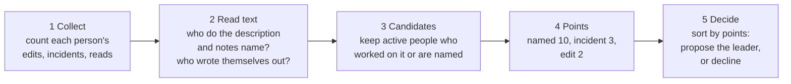

# The rules scorer

> **Where this stands.** This file explains the owner rules as they were first built, as a standalone script. The rules are unchanged, but the live implementation is now `owner_agent/proposing/rules.py` (with the model step in `owner_agent/proposing/text_facts.py`), and the `propose` command runs them from SQLite. The numbers in sections 8 and 9 are the standalone scorer's measurements; the current results, including the model-assisted mode, are in [EVAL.md](../EVAL.md).

`scorer.py` takes one orphaned asset and answers: **who is the owner, or nobody, and how sure are we?** This file explains how. It covers the rules and the confidence. The model (LLM) is built on top of this (section 7).

```
python scorer.py --seed fixture/seed.jsonl --asset a_0974     # explain one asset
python scorer.py --seed fixture/seed.jsonl --all              # every orphan, one JSON line each
python eval_scorer.py --dir fixture                           # grade it on the calibration split
python calibrate.py --dir fixture                             # measure the confidence, pick the threshold
python scorer.py --seed fixture/seed.jsonl --asset a_0974 --confidence confidence.json
```

## 1. Input and output

**Input:** an asset id, plus the catalog. The scorer loads the catalog once and indexes it, so everything about one asset is a direct lookup.

| What the scorer looks up | For asset a_0974 |
|---|---|
| The asset record | its name, type and description |
| Its signals | the 40 edits, incidents and reads on it, each with a user and a note |
| Its edges | the 3 assets it feeds |
| The users | each user's name, team, person or robot, active or left |

It never reads `truth.jsonl`. Grading is a separate script, `eval_scorer.py`.

**Output:** one result per asset.

| Field | Meaning |
|---|---|
| `owner` | a user id, or null when the scorer declines |
| `why` | which rule decided (section 5) |
| `reason` | a sentence a reviewer can read, with the points |
| `candidates` | everyone it compared, sorted by points |
| `not_candidates` | people it set aside, and why |
| `signal_ids`, `edge_ids` | the evidence behind the decision |
| `group`, `unread_text` | which confidence group the answer is in, and any text the rules could not read (section 8) |
| `confidence`, `auto_approve` | how sure the answer is, and whether approve-batch would take it (section 8) |

## 2. The five steps



There is one pass through these steps for each asset. The candidates live in a dictionary keyed by user id while the asset is being scored. At step 5 it becomes a list sorted by points.

The design is **one points rule, plus two fixed declines** (section 5). Step 3 decides who is allowed to be compared at all; the points decide between them.

## 3. A worked example: a_0974

`warehouse.platform.kyc_checks_snapshot`, a table with an empty description.

**Step 1, collect.** Five people touched it:

| Who | Team | Edits | Incidents | Reads |
|---|---|---|---|---|
| Mei Lindqvist | platform-eng | 6 | 2 | 0 |
| Kira Ferreira | finance-data | 0 | 1 | 25 |
| Petra Silva (left) | platform-eng | 0 | 0 | 3 |
| Goran Haddad, Maeve Tanaka | other | 0 | 0 | 1–2 each |

Kira Ferreira also owns the 3 assets this table feeds.

**Step 2, read text.** The description is empty and the incident notes are routine ("Restarted the load…"). So there are no mentions.

**Step 3, candidates.**
- The three people who only read are out.
- Mei and Kira stay: each has an edit or an incident.

**Step 4, points.**

| Candidate | Points |
|---|---|
| Mei Lindqvist | 6 edits × 2 + 2 incidents × 3 = **18** |
| Kira Ferreira | 1 incident × 3 = **3** (25 reads and 3 neighbouring assets count for nothing) |

**Step 5, decide.** Mei leads by 15 points, which is more than 2. **Answer: Mei Lindqvist.**

The reason the scorer writes: *"Mei Lindqvist (platform-eng): 6 edits = 12, 2 incidents = 6 -> 18 points. Next: Kira Ferreira (finance-data): 1 incident = 3 -> 3 points. Lead of 15 points."*

Counting all activity would have picked Kira, who has 26 signals against Mei's 8.

## 4. The precedence

**Who can be a candidate (step 3).** An active person who edited the asset, handled an incident on it, or is named in its text. Never:

| Not a candidate | Example |
|---|---|
| A robot | svc_airflow with 26 edits |
| A person who has left | Imani Kaur with 7 edits |
| A person who only reads | Rafael Sato with 22 reads |
| A person who wrote themselves out | "I no longer maintain this", "Handed this to X", "Escalated to X, who maintains this" |

**Points (step 4).**

| Evidence | Points |
|---|---|
| Named as the maintainer in a description or note, or says "I maintain this" in their own note | **10**, once, however many texts name them |
| Incident response | **3** each |
| Edit | **2** each |
| Reads, generic text, owning a neighbouring asset | **0** |

So being named is worth 5 edits, and an incident 1.5 edits. There are no caps.

**What the rules read in text (step 2).**

| Text | Where | Effect |
|---|---|---|
| "Maintained by X", "Built and maintained by X", "Owned and maintained by X (team)", "Owned by X", "Maintainer: X" | description | X is named |
| "Escalated to X, who maintains this…", "Questions go to X; they maintain this" | note | X is named; the writer is out |
| "Handed this to X…" | note | X is named; the writer is out |
| "I no longer maintain this" | note | the writer is out |
| "…; I maintain this job" | note | the writer is named |

**Who a name means.** A full name ("Farah Demir"), or a first name with a team ("Farah (platform-eng)"). The name must match exactly one active person. A first name alone, an unknown name, a name shared by two users, a robot, or someone who has left all name nobody.

## 5. The decision (step 5)

The scorer checks these in order and stops at the first that applies.

| # | Situation | Answer | `why` |
|---|---|---|---|
| 1 | No candidates | decline | `nobody` |
| 2 | Two texts name different people | decline | `texts_disagree` |
| 3 | Text names one person, and someone else has more points | decline | `conflict` |
| 4 | The leader is ahead of the next candidate by 2 points or less | decline | `close` |
| 5 | Only one candidate | that person | `only_candidate` |
| 6 | The leader is ahead by more than 2 points | the leader | `clear_lead` |

A decline still explains itself and says which way the scorer leans. Two real ones:

- a_0500: *"Too close to call. Beatriz Adeyemi: 4 edits = 8 points. Valeria Silva: 3 edits = 6 points. Beatriz Adeyemi is slightly ahead, but a lead of 2 is not enough."*
- a_1359: *"The text names Laszlo Silva, but Santiago Brennan has more points. Laszlo Silva: named in the description = 10. Santiago Brennan: 18 edits = 36. The text and the work disagree."*

## 6. How each case is decided

| Case | What happens in the scorer | Example |
|---|---|---|
| clear_owner | One candidate, or a clear lead | a_1208: Akira Adeyemi is the only candidate (16 points); a 22-read reader doesn't count |
| service_or_inactive_top_user | Robots and people who left are dropped at step 3. What remains is one active editor, or nobody | a_1545: Imani Kaur has left → `nobody` |
| tied_evidence | Equal points → `close` | 4 edits + 1 incident each: 11 vs 11 |
| near_tie | A lead of 1–2 points → `close` | a_0500: 8 vs 6 |
| text_only_evidence | The named person has 10 points and is the only candidate; or the name means nobody → `nobody` | a_0064: the description names Wanjiru Haddad, who has left → `nobody` |
| no_signals | No candidates → `nobody`. Neighbours' owners are not candidates | |
| readers_only | Readers are not candidates → `nobody` | |
| cross_team_decoy | The decoy only reads, or has 1 edit or incident; the editor leads clearly | a_0974 (section 3) |
| conflict | 10 points for the text against the other person's activity. Clearly ahead → the named person; within 2 → `close`; behind → `conflict` | a_0348: named 10 vs 6 edits = 12 → `conflict` |
| handover | The writer is out; the person named has 10 points. If that person has left → `nobody` | a_2638: Nico Eze handed over to Mei Lindqvist → Mei, even though the description still names Nico |
| disowned | The writer is out. A successor who edits is then the only candidate; otherwise `nobody` | |
| two_texts | The same person in both texts → that person. Different people → `texts_disagree` | a_0059: the description names Joss Trent, and Yara Schmidt writes "I maintain this job" |
| cross_team_owner | The team is not used for the answer. The editor is the only candidate | |

## 7. Where the model (LLM) will fit

The rules do everything in steps 1, 3, 4 and 5. The model only helps with **step 2**, reading text.

- **Today:** step 2 recognises the exact wordings in section 4. A different wording, such as "Passing this one to Rafael Castillo from now on", is not understood, so that text is ignored. The dataset has 54 orphans with such text (section 9).
- **Later:** for text the rules can't parse, the model reads the description and notes and returns the same kind of record the rules produce: *who is named, who hands over, who disowns, who claims it*. Those records go into the same step 3. The points and the decision don't change.
- **So the model never picks the owner and never sets the points.** It only turns free text into the structured mentions the rules already use.

In the code this is one place: `score_asset(catalog, asset_id, extra_mentions=...)`. The baseline run passes nothing there.

## 8. Confidence

The points decide **who**. The confidence says **how sure**: a number from 0 to 1 on every answer.

| The scorer's answer | What its confidence means |
|---|---|
| A name | how likely that person really is the owner |
| none | how likely "none" is the right answer |

**When the answer is none.** The rules in section 5 decide that, not the confidence. The scorer declines when nobody is a candidate, when two texts disagree, when the text and the work disagree, or when the top two are within 2 points. The confidence is attached afterwards.

**How the number is made.** Each answer falls into one group, using only what the scorer can see. `calibrate.py` then counts, on the calibration split, how often each group was right. The confidence is (right + 1) ÷ (total + 2), so no group claims certainty and small groups are trusted less.

| Group | Right on calibration | Confidence |
|---|---|---|
| Proposes on activity (5 points or more) | 73 of 73 | 0.99 |
| Proposes the person named in the text | 45 of 45 | 0.98 |
| Proposes on thin activity (one or two edits, or one incident) | 7 of 7 | 0.89 |
| Proposes, but the asset has text the rules could not read | 3 of 18 | 0.20 |
| Declines: no candidates | 57 of 57 | 0.98 |
| Declines: too close, or the evidence disagrees | 36 of 36 | 0.97 |
| Declines, but the asset has text the rules could not read | 3 of 9 | 0.36 |

**The methods we considered.** Turning what a scorer knows into an honest probability is called calibration. These are the usual ways to do it:

| Method | How it works | Why we did or didn't use it |
|---|---|---|
| **Share of points** (leader ÷ total, e.g. 14 ÷ 17) | Simple arithmetic; needs no labelled data | **Rejected.** On calibration, 126 of 143 proposals have only one candidate, so they all get 100%, including 11 of the 15 wrong ones. A lone person with a single edit also gets 100%. |
| **Platt scaling** | Fit a smooth curve from one number, such as the points lead, to the chance of being right | **Not used.** It needs one number that predicts mistakes. Ours doesn't: wrong proposals have leads from 3 to 32 points. |
| **Isotonic regression** | The same idea with a stepped curve | **Not used.** It needs much more data than our 143 proposals. |
| **Histogram binning** (groups) | Put answers into a few groups and give each the share that was right | **Chosen.** Our mistakes are marked by a yes/no fact (the asset has text the rules could not read), and groups can use a yes/no fact directly. It is also easy to explain and to check. |

We use few groups, because each one needs enough answers to measure. If a single number that predicts mistakes turns up later, a Platt curve on it is the natural upgrade.

**Text the rules could not read.** The scorer can't use such text, but it can see that it is there: a note or description that is neither a known wording nor routine. That is the strongest warning sign in the data. All 15 wrong proposals and all 6 wrong declines on calibration are in those two groups.

**The threshold.** `approve-batch` approves a proposal only when its confidence is at or above the threshold. `calibrate.py` sets the threshold to the target, **0.95**, and prints what that means:

| Approve at or above | Approved | Wrong | Precision | Coverage |
|---|---|---|---|---|
| 0.99 | 73 | 0 | 1.00 | 30% |
| 0.98 | 118 | 0 | 1.00 | 48% |
| 0.89 | 125 | 0 | 1.00 | 51% |
| 0.20 | 143 | 15 | 0.90 | 58% |

At 0.95:
- **Auto-approved:** proposals on activity, and proposals of the person named in the text. On calibration that is 118 proposals with 0 wrong.
- **Sent to a person:** thin proposals, and proposals on assets with text the rules could not read.
- **Never approved:** every decline. A person can still set an owner by hand. A low-confidence decline (0.36) tells them an owner is probably there.

**Where the numbers live.** `calibrate.py` writes them to `confidence.json`. The scorer only looks them up, so it still never reads the truth file. To move the bar, run `python calibrate.py --dir fixture --target 0.9`.

**What these numbers do not prove.**
- We built the dataset so that the only mistakes come from text the rules can't read. Real data will have other mistakes, so 0.98 and 0.99 are optimistic.
- The 0.20 and 0.36 reflect our mix: five orphans with text that matters for every one with harmless text.
- Thin proposals are right in our data (7 of 7), but the examiners' data has no owner with so little evidence. That is why they stay below the threshold.

## 9. Results so far

On the **calibration** split (245 orphans):

| Measure | Result |
|---|---|
| Correct | 224 of 245 |
| Precision (proposals that are right) | 128 of 143 |
| Coverage (orphans that get a proposal) | 143 of 245 |
| Correct declines | 96 of 102 |

**Where the 21 mistakes are.** All of them are on orphans whose answer depends on text in a wording the rules don't know (`scenarios.md` section 3.5). The dataset contains these on purpose.

| Orphans in calibration | Right |
|---|---|
| Text in a known wording, or no text | 218 of 218 |
| Text the rules can't read, which changes the answer | 0 of 21 |
| Text the rules can't read, which changes nothing | 6 of 6 |

Two typical mistakes:
- **A wrong proposal.** Reza Tanaka made 5 edits, then wrote a handover note in an unknown wording. The rules don't see the handover, so they propose Reza. The right answer is the person he handed it to.
- **A wrong decline.** A description names the maintainer in an unknown wording and only robots edit. The rules see nobody, so they decline.

**A caution.** The dataset was labelled with the same rule, so being right on every known wording shows the code follows the rule, not that the rule is right.

**On the examiners' reference set** (40 orphans, labelled by them): 40 of 40 correct, with 27 proposals and 13 declines. All 27 proposals are above the 0.95 threshold. Two things limit what this shows:
- The reference labels were read early on to understand the examiners' intent, so this is not an unseen test.
- The reference set has no text in unknown wordings, no thin evidence, no near ties and no handovers, so it tests only the basic rules.

The held_out split of our own fixture has not been looked at.

## 10. Built since this was written

- **The model** reads text in other wordings exactly as section 7 planned: `owner_agent/proposing/text_facts.py` turns the model's facts into the same mentions, after checking every quote.
- **The `propose` command** runs the five steps from SQLite and writes proposals: `owner_agent/proposing/propose.py`.
- **Results** for both modes, the threshold and the wrong-proposal analysis: [EVAL.md](../EVAL.md). Commands: the [README](../README.md).
